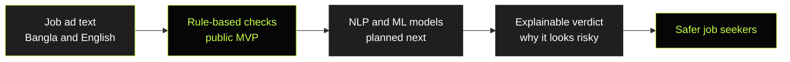
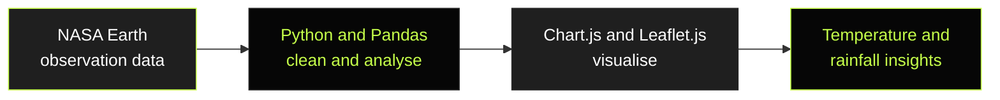
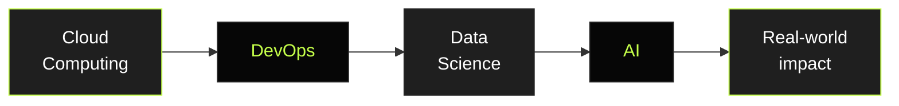

  

  <h1>Sohan Rana</h1>

  

    <b>Where AI meets people, not just data.</b> 
    Software Engineering student building explainable, human-centered technology for Bangla NLP, IoT and climate.
  

  

  

    
    
    
    
  

  

    
    
    
    
    
    
    
    
    
  

  

    <a href="https://sohan-rana.github.io/SOHAN/">Portfolio</a> •
    <a href="#projects">Projects</a> •
    <a href="#research">Research</a> •
    <a href="#honqio-it">Honqio IT</a> •
    <a href="#technologies--tools">Technologies</a> •
    <a href="#github-stats">GitHub Stats</a> •
    <a href="#contact">Contact</a>
  

---

> **Open to** internships, research collaboration, and AI / NLP / HCI / data science projects. Say hello at **[sohanrana243@gmail.com](mailto:sohanrana243@gmail.com)**.

---

### 🧭 About

I work where Artificial Intelligence, Human-Computer Interaction and Natural Language Processing meet real human needs, always asking one question: **who does this technology actually help?**

I study Software Engineering at Daffodil International University in Dhaka, started with software development and practical problem-solving, and moved toward research-driven, human-centered AI.

---

## Projects

### 🛡️ BanglaJobGuard

Explainable hybrid AI that flags fraudulent and suspicious job ads in the Bangla job market. IEEE-format paper written, rule-based public MVP live, NLP/ML models next.

### 🌍 EarthLens (NASA Space Apps Challenge 2026)

Bangladesh Environmental Trend Detective. Turns NASA Earth observation data into accessible visual insights about temperature and rainfall trends. Team Cosmic Mindshift, 14-15 Nov 2026.

### 🌾 Smart Field Alert System (published)

Low-cost Arduino-based intrusion detection for farmland using a PIR HC-SR501 sensor. Published on [ResearchGate](https://www.researchgate.net/publication/404114451_Smart_Field_Alert_System_Using_Arduino_for_Agricultural_Intrusion_Detection).

<b>More projects</b>

- **Honqio IT website**: HTML, CSS, JavaScript, Netlify
- **DIU Bus Service Automation**: React, Node.js, MySQL
- **Real Estate Management System**: MySQL, XAMPP
- **Blood Donation & Emergency Matching App**: capstone concept

---

## Research

Focus areas: HCI, AI Ethics, Bangla NLP, Human-Centered AI. Also taking part in youth-led climate initiatives, including RCOY APAC 2026.

---

## Honqio IT

**Co-founder & COO.** A technology startup delivering practical digital solutions for individuals and organizations.

---

## Technologies & Tools

  
  
  
  
  
  
  
  
  
  
  
  

**Learning now**

  
  
  
  
  
  
  

---

## GitHub Stats

 

  

<!-- Cards generated by .github/workflows/profile-summary.yml (saved in profile-summary-card-output/) -->
<picture>
  <source media="(prefers-color-scheme: dark)" srcset="profile-summary-card-output/github_dark/0-profile-details.svg">
  
</picture>
<picture>
  <source media="(prefers-color-scheme: dark)" srcset="profile-summary-card-output/github_dark/2-most-commit-language.svg">
  
</picture>

<picture>
  <source media="(prefers-color-scheme: dark)" srcset="profile-summary-card-output/github_dark/3-stats.svg">
  
</picture>
<picture>
  <source media="(prefers-color-scheme: dark)" srcset="profile-summary-card-output/github_dark/4-productive-time.svg">
  
</picture>

  

<!-- Snake eating the contribution graph (.github/workflows/snake.yml) -->
<picture>
  <source media="(prefers-color-scheme: dark)" srcset="https://raw.githubusercontent.com/Sohan-Rana/Sohan-Rana/output/github-snake-dark.svg">
  
</picture>

---

## Contact

I'll be happy to receive any feedback, ideas or code reviews that can help me improve 💪
⭐️ Follow me, your support means a lot!

Thank you for visiting my page ❤️

  Engineered with curiosity in Dhaka by <a href="https://github.com/Sohan-Rana"><b>@Sohan-Rana</b></a>.

